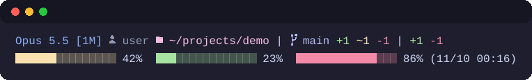
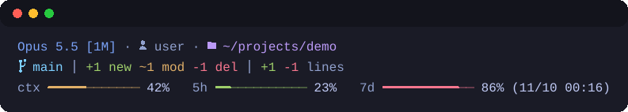

<p align="center">
  
</p>

<h1 align="center">oh-my-claude</h1>

<p align="center">
  <strong>See where you are. Keep what you learn.</strong><br>
  A themeable statusline and a local knowledge base for Claude Code.
</p>

<p align="center">
  <a href="https://github.com/sw-willie-wu/oh-my-claude/tags"></a>
  <a href="https://github.com/sw-willie-wu/oh-my-claude/blob/main/LICENSE"></a>
</p>

---

<p align="center">English | <a href="README.zh-TW.md">繁體中文</a></p>

This marketplace ships two plugins for [Claude Code](https://claude.com/claude-code): **oh-my-status** and **oh-my-knowledge**. They update together on each release.

## oh-my-status

A themeable statusline for Claude Code.

<p align="center">
  
  <br>
  
</p>

- 9 themes × 6 layouts, switchable on the fly.
- Account, context, 5h and 7d usage at a glance.
- Cheap on Windows: about 2 processes per render, and git info is cached and invalidated by `.git` changes.

```
/plugin marketplace add sw-willie-wu/oh-my-claude
/plugin install oh-my-status@oh-my-claude
/reload-plugins
/oh-my-status:setup
```

Restart Claude Code to see the statusline.

## oh-my-knowledge

A local, git-versioned knowledge base. Durable knowledge (decisions and their reasons, pitfalls, conventions, root causes) lives in one folder you own, while project progress stays in each project's auto memory.

- **lookup**: before answering a problem-style question, search the knowledge base and the project's auto memory.
- **distill**: write what the session learned into knowledge pages.
- **handoff**: at the end of a session, rewrite the project's progress, then distill.
- **lint**: health check for broken links, stale or contradictory pages and leftovers.

```
/plugin marketplace add sw-willie-wu/oh-my-claude
/plugin install oh-my-knowledge@oh-my-claude
/reload-plugins
/oh-my-knowledge:setup
```

Restart the session after setup.

## Documentation

- [Statusline: themes, layouts, usage, customizing](docs/statusline.md)
- [Installing oh-my-status](docs/install.md)
- [Upgrading](docs/upgrading.md)
- [oh-my-knowledge](docs/knowledge.md)
- [Changelog](CHANGELOG.md)

## License

[MIT](LICENSE)
