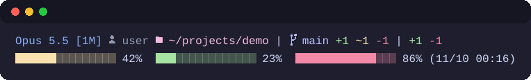
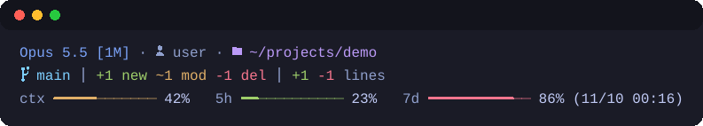

<p align="center">
  
</p>

<h1 align="center">oh-my-claude</h1>

<p align="center">
  <strong>看得見現況，留得住經驗。</strong><br>
  Claude Code 的可換主題 statusline 與本機知識庫。
</p>

<p align="center">
  <a href="https://github.com/sw-willie-wu/oh-my-claude/tags"></a>
  <a href="https://github.com/sw-willie-wu/oh-my-claude/blob/main/LICENSE"></a>
</p>

---

[English](README.md) | 繁體中文

這個 marketplace 為 [Claude Code](https://claude.com/claude-code) 提供兩個外掛：**oh-my-status** 與 **oh-my-knowledge**，每次發版一起更新。

## oh-my-status

Claude Code 的可換主題 statusline。

<p align="center">
  
  <br>
  
</p>

- 9 種主題 × 6 種版型，隨時切換。
- 帳號、context、5 小時與 7 天用量一眼看清。
- 在 Windows 上很省：每次繪製約 2 個行程，git 資訊有快取，`.git` 一變動就會失效重抓。

```
/plugin marketplace add sw-willie-wu/oh-my-claude
/plugin install oh-my-status@oh-my-claude
/reload-plugins
/oh-my-status:setup
```

設定完成後請重開 Claude Code。

## oh-my-knowledge

本機、用 git 版控的知識庫。決策與原因、踩過的雷、慣例、根因這些長期知識集中放在你自己的一個資料夾，專案進度則留在各專案的 auto memory。

- **lookup**：回答疑難類問題前，先搜尋知識庫與該專案的 auto memory。
- **distill**：把這次 session 學到的東西寫進知識頁。
- **handoff**：session 結束時改寫專案進度，再跑 distill。
- **lint**：健檢斷鏈、過期或互相矛盾的頁面與殘留檔。

```
/plugin marketplace add sw-willie-wu/oh-my-claude
/plugin install oh-my-knowledge@oh-my-claude
/reload-plugins
/oh-my-knowledge:setup
```

設定完成後請重開 session。

## 文件

文件為英文。

- [Statusline：主題、版型、用法、自訂](docs/statusline.md)
- [安裝 oh-my-status](docs/install.md)
- [升級](docs/upgrading.md)
- [oh-my-knowledge](docs/knowledge.md)
- [Changelog](CHANGELOG.md)

## 授權

[MIT](LICENSE)
